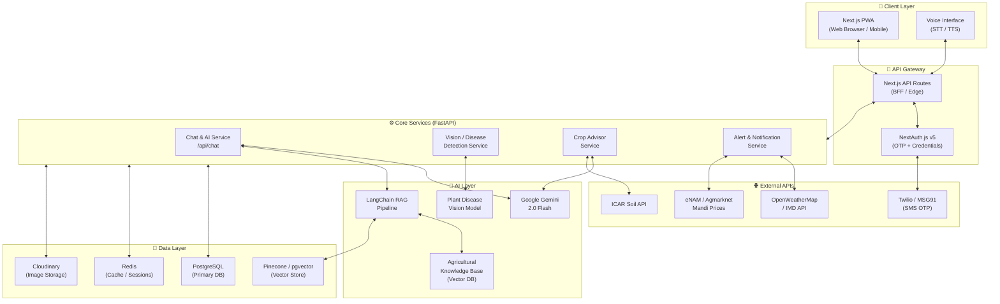
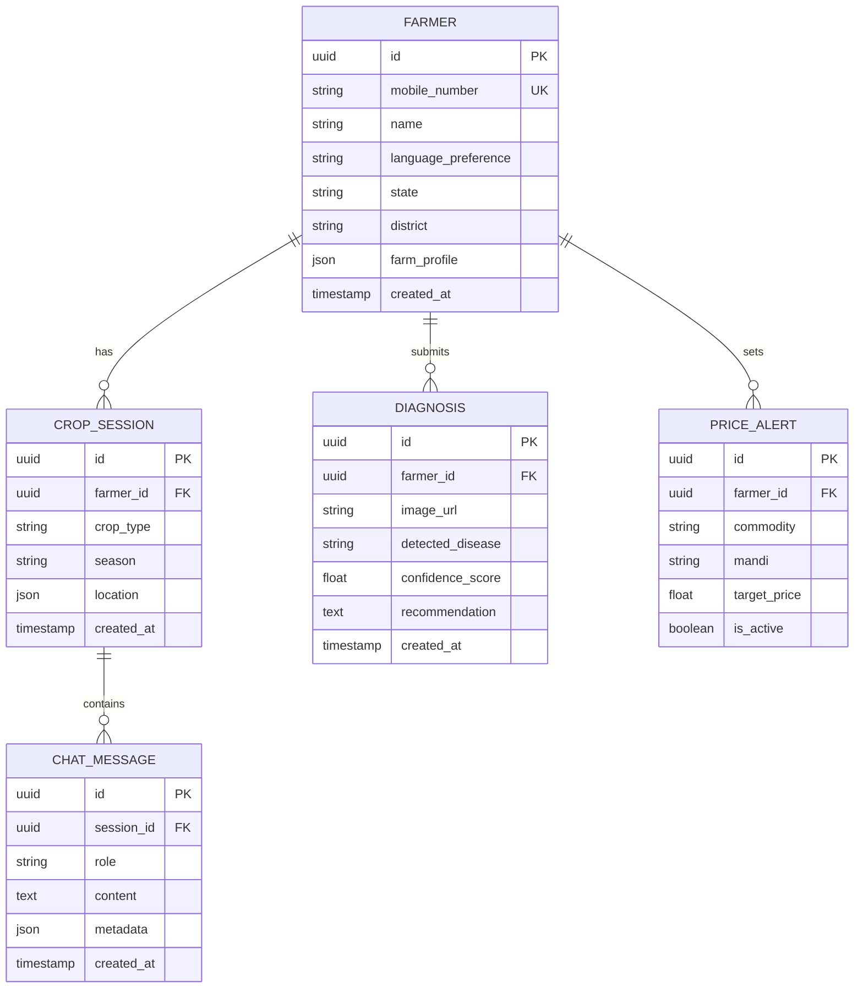
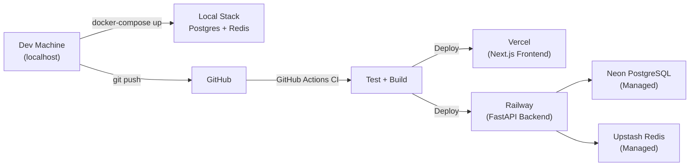

# 🏗️ AgriSathi AI — System Architecture

> Version 0.1 · Draft · Last updated: 2026-11-21

---

## High-Level Architecture



---

## Monorepo Structure

```
AgriSathi-AI/
├── apps/
│   ├── web/                    # Next.js 15 frontend (PWA)
│   │   ├── app/                # App Router pages
│   │   │   ├── (auth)/         # Login, OTP, register
│   │   │   ├── (dashboard)/    # Farmer dashboard
│   │   │   ├── chat/           # AI chat interface
│   │   │   ├── diagnose/       # Plant disease upload
│   │   │   ├── weather/        # Weather dashboard
│   │   │   ├── prices/         # Mandi prices
│   │   │   ├── community/      # Q&A forum
│   │   │   └── api/            # Next.js API routes (BFF)
│   │   ├── components/         # UI components
│   │   │   ├── ui/             # shadcn/ui base components
│   │   │   ├── chat/           # Chat-specific components
│   │   │   ├── forms/          # Form components
│   │   │   └── layout/         # Header, sidebar, footer
│   │   ├── lib/                # Client utilities
│   │   ├── hooks/              # Custom React hooks
│   │   ├── stores/             # Zustand state stores
│   │   ├── i18n/               # Translations (11 languages)
│   │   │   ├── en.json
│   │   │   ├── hi.json
│   │   │   ├── ta.json
│   │   │   └── ...
│   │   ├── public/             # Static assets, icons, manifest
│   │   ├── next.config.ts
│   │   ├── tailwind.config.ts
│   │   └── package.json
│   │
│   └── api/                    # FastAPI Python backend
│       ├── app/
│       │   ├── main.py         # FastAPI entrypoint
│       │   ├── config.py       # Settings (pydantic-settings)
│       │   ├── routers/        # Route modules
│       │   │   ├── chat.py
│       │   │   ├── vision.py
│       │   │   ├── crop.py
│       │   │   ├── weather.py
│       │   │   ├── prices.py
│       │   │   └── auth.py
│       │   ├── services/       # Business logic
│       │   ├── models/         # Pydantic schemas
│       │   ├── db/             # DB session, migrations
│       │   └── utils/
│       ├── tests/
│       ├── requirements.txt
│       └── Dockerfile
│
├── packages/
│   ├── shared/                 # Shared TypeScript types
│   ├── ui/                     # Shared UI component library
│   └── config/                 # Shared ESLint, TS, Tailwind configs
│
├── infra/
│   ├── docker-compose.yml      # Local dev stack
│   ├── docker-compose.prod.yml
│   └── nginx/
│
├── docs/                       # Additional documentation
├── scripts/                    # Dev utility scripts
├── .github/
│   └── workflows/              # CI/CD (GitHub Actions)
├── .env.example
├── .gitignore
├── .gitattributes
├── .editorconfig
├── PROJECT_PLAN.md
├── ARCHITECTURE.md
├── IMPLEMENTATION_STATUS.md
└── README.md
```

---

## Technology Stack

### Frontend (apps/web)

| Layer | Technology | Version |
|---|---|---|
| Framework | Next.js (App Router) | 15.x |
| Language | TypeScript | 5.x |
| Styling | Tailwind CSS | 4.x |
| UI Components | shadcn/ui + Radix UI | Latest |
| State | Zustand + React Query (TanStack) | Latest |
| Forms | React Hook Form + Zod | Latest |
| Auth Client | NextAuth.js | v5 |
| i18n | next-intl | Latest |
| Charts | Recharts / Tremor | Latest |
| PWA | next-pwa (Workbox) | Latest |
| Animation | Framer Motion | Latest |
| Icons | Lucide React | Latest |

### Backend (apps/api)

| Layer | Technology | Version |
|---|---|---|
| Framework | FastAPI | 0.115.x |
| Language | Python | 3.14.x |
| ORM | SQLAlchemy 2 + Alembic | Latest |
| Validation | Pydantic v2 | Latest |
| AI SDK | LangChain + Google Gen AI | Latest |
| Task Queue | Celery + Redis | Latest |
| HTTP Client | HTTPX | Latest |
| Testing | pytest + pytest-asyncio | Latest |

### Infrastructure

| Component | Technology |
|---|---|
| Primary DB | PostgreSQL 16 |
| Cache / Queue | Redis 7 |
| Vector Store | pgvector (embedded in Postgres) |
| Image Storage | Cloudinary |
| Email | Resend |
| SMS / OTP | MSG91 (India-focused) |
| Monitoring | Sentry (errors) + Uptime Kuma |
| Container | Docker + Docker Compose |

### AI & ML

| Component | Technology |
|---|---|
| LLM | Google Gemini 2.0 Flash |
| Embeddings | text-embedding-004 |
| Vision | Gemini Vision / fine-tuned PlantVillage model |
| RAG Framework | LangChain |
| Knowledge Base | ICAR guidelines, Krishi Vigyan Kendra data |
| Speech-to-Text | Google Cloud Speech-to-Text v2 |
| Text-to-Speech | Google Cloud Text-to-Speech |

---

## Data Models (Core)



---

## API Design (REST + SSE)

### Key Endpoints

```
POST   /api/v1/auth/otp/request       # Request OTP
POST   /api/v1/auth/otp/verify        # Verify OTP + issue JWT
GET    /api/v1/farmers/me             # Farmer profile
PUT    /api/v1/farmers/me             # Update profile

POST   /api/v1/chat/message           # Send message → SSE stream
GET    /api/v1/chat/history/{session} # Chat history
DELETE /api/v1/chat/history/{session} # Clear history

POST   /api/v1/diagnose/upload        # Upload plant image → diagnosis
GET    /api/v1/diagnose/{id}          # Get diagnosis result

GET    /api/v1/weather/current        # Current weather by lat/lon
GET    /api/v1/weather/forecast       # 7-day forecast

GET    /api/v1/prices/live            # Live mandi prices
GET    /api/v1/prices/history         # Price history
POST   /api/v1/prices/alert           # Set price alert

GET    /api/v1/crops/recommend        # Crop recommendation
GET    /api/v1/crops/calendar         # Crop calendar
```

---

## Security Architecture

- **Auth**: JWT (short-lived access + long-lived refresh) + mobile OTP
- **API**: Rate limiting (slowapi), CORS strict origin list
- **Input validation**: Pydantic v2 strict mode + Zod on frontend
- **Image uploads**: Signed Cloudinary upload URLs (never raw S3 exposure)
- **Secrets**: Environment variables only — never hardcoded
- **HTTPS**: Enforced at Nginx/Vercel/Railway layer
- **SQL injection**: SQLAlchemy ORM (parameterized queries only)
- **XSS**: React auto-escaping + CSP headers

---

## Offline / PWA Strategy

```
Network available:
  → Fetch fresh data → Cache in IndexedDB → Render

Network unavailable:
  → Serve from Service Worker cache
  → Queue mutations (chat, alerts) in background sync
  → Show offline banner, degrade gracefully
  → Push notifications resume when online
```

---

## Deployment Architecture


